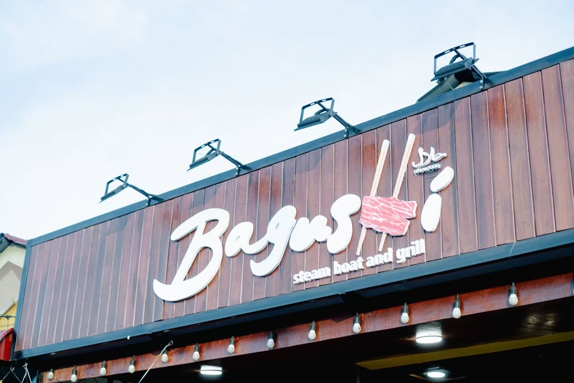

<!DOCTYPE html>
<html lang="en">
<head>
    <meta charset="UTF-8">
    <meta name="viewport" content="width=device-width, initial-scale=1.0">
    <title>Bagushi Steamboat & Grill Changlun</title>
    <link rel="stylesheet" href="https://cdnjs.cloudflare.com/ajax/libs/font-awesome/6.4.0/css/all.min.css">
    
</head>
<body>

    <!-- PAGE 1: Welcome Screen -->
    

        

            <i class="fa-solid fa-bars"></i>
            

                <i class="fa-regular fa-bell"></i> &nbsp;
                <i class="fa-solid fa-share-nodes"></i> &nbsp;
                <i class="fa-solid fa-magnifying-glass"></i>
            

        

        
        <h1 class="title-large">BAGUSHI STEAMBOAT & GRILL CHANGLUN</h1>
        
Digital Ordering System & Fast Service

        <button class="btn-primary" onclick="goToPage(2)">Next</button>
    

    <!-- PAGE 2: Login / Register Form -->
    

        

            <i class="fa-solid fa-bars"></i>
            

                <i class="fa-regular fa-bell"></i> &nbsp;
                <i class="fa-solid fa-share-nodes"></i> &nbsp;
                <i class="fa-solid fa-magnifying-glass"></i>
            

        

        <h1 class="title-large">BAGUSHI STEAMBOAT & GRILL CHANGLUN</h1>
        
Customer Sign In

        
        <input type="text" id="loginEmail" class="form-input" placeholder="Name / Email" required>
        
        

            <input type="password" id="loginPassword" placeholder="Password" required>
            <i class="fa-solid fa-eye toggle-password" id="togglePassword" onclick="togglePasswordVisibility()"></i>
        

        
        <button class="btn-primary" style="margin-top: 10px;" onclick="handleSignIn()">Sign In</button>
        

            <small onclick="goToPage(9)" style="cursor: pointer; text-decoration: underline; color: #666;">(Staff/Kitchen Access - Page 9)</small>
        

    

    <!-- PAGE 3: Confirm Table Number -->
    

        

            <i class="fa-solid fa-bars"></i>
            

                <i class="fa-regular fa-bell"></i> &nbsp;
                <i class="fa-solid fa-share-nodes"></i> &nbsp;
                <i class="fa-solid fa-magnifying-glass"></i>
            

        

        
        <h2 class="title-large">SELECT TABLE</h2>
        
Please confirm your table number to view the menu.

        
        <select id="selectMeja" class="form-input" style="font-weight: bold;">
            <option value="">-- Select Table Number --</option>
            <option value="Table 01">Table 01</option>
            <option value="Table 02">Table 02</option>
            <option value="Table 05">Table 05</option>
            <option value="Table 08">Table 08</option>
            <option value="Table 12">Table 12</option>
        </select>
        
        <button class="btn-primary" onclick="confirmTable()">View Menu</button>
    

    <!-- PAGE 4: Main Categories / Recommendations & Search Menu -->
    

        

            Menu Search
            <i class="fa-solid fa-cart-shopping" onclick="goToPage(7)" style="font-size:1.3rem;">
                0
            </i>
        

        <input type="text" id="searchMenuInput" class="form-input" placeholder="🔍 Search menu (e.g., Beef, Chicken...)" oninput="filterMenu(this.value)">
        
        

            
Search Results:

            

            

        

        

            
Suggestions / Categories

            

                Best Sellers
                <i class="fa-solid fa-chevron-right"></i>
            

            

                Steamboat & Grill Sets
                <i class="fa-solid fa-chevron-right"></i>
            

            

                Meat & Seafood
                <i class="fa-solid fa-chevron-right"></i>
            

            

                Drinks & Desserts
                <i class="fa-solid fa-chevron-right"></i>
            

        

    

    <!-- PAGE 5: Food Categories Grid -->
    

        

            

                <i class="fa-solid fa-chevron-left" onclick="goToPage(4)"></i>
                Food Categories
            

            

                <i class="fa-solid fa-magnifying-glass"></i> &nbsp;
                <i class="fa-regular fa-user"></i> &nbsp;
                <i class="fa-solid fa-bag-shopping" onclick="goToPage(7)">
                    0
                </i>
            

        

        

        

            <small style="color:#777;">Showing all items</small>  
            <button class="btn-primary" onclick="goToPage(7)">Go to Cart (0)</button>
        

    

    <!-- PAGE 6: Product Detail & Special Request -->
    

        

            <i class="fa-solid fa-chevron-left" onclick="goToPage(5)"></i>
            

                <i class="fa-solid fa-magnifying-glass"></i> &nbsp;
                <i class="fa-regular fa-user"></i> &nbsp;
                <i class="fa-solid fa-bag-shopping" onclick="goToPage(7)">
                    0
                </i>
            

        

        <h2 id="detailName" style="margin-bottom: 10px;">Sliced Beef Premium</h2>
        

            
            <i class="fa-regular fa-heart heart-icon" style="font-size: 1.3rem;"></i>
        

        
Price: RM 12.00

        <label style="font-weight: bold; display: block; margin-top: 15px; margin-bottom: 5px;">Special Request:</label>
        <input type="text" id="specialRequest" class="form-input" placeholder="E.g., Less spicy / Extra soup">

        <button class="btn-primary" onclick="addCurrentDetailToCart()">Add to Cart</button>

        

        
Customer Reviews

        

            
            

                <small style="font-weight: bold;">Bagushi Popular Menu</small> 
                <small>⭐⭐⭐⭐⭐ (5/5)</small>
            

        

    

    <!-- PAGE 7: My Cart & Checkout -->
    

        

            <i class="fa-solid fa-chevron-left" onclick="goToPage(5)"></i>
            <h2>My cart</h2>
        

        

        

            

                Total
                RM 0.00
            

            <button class="btn-primary" onclick="checkout()">Checkout</button>
        

    

    <!-- PAGE 8: Customer Order Status -->
    

        

            <i class="fa-solid fa-chevron-left" onclick="goToPage(7)"></i>
            <h2 class="header-title" style="font-size: 1.2rem;">Order Status</h2>
        

        

            

                

                Order Received
            

            

                

                Preparing
            

            

                

                Ready to Serve
            

        

        

            
Your order is being processed by the Bagushi kitchen.

            <button class="btn-primary" onclick="goToPage(9)">Go to Staff Dashboard (Page 9)</button>
        

    

    <!-- PAGE 9: Kitchen / Incoming Orders Dashboard -->
    

        

            <i class="fa-solid fa-chevron-left" onclick="goToPage(1)"></i>
            <h2 class="header-title">Incoming Orders</h2>
        

        

            <button class="btn-primary" style="padding: 6px; font-size:0.75rem;">All (3)</button>
            <button class="btn-primary" style="padding: 6px; font-size:0.75rem; background:#888;">Preparing (2)</button>
            <button class="btn-primary" style="padding: 6px; font-size:0.75rem; background:#888;">Ready (1)</button>
        

        <table>
            <thead>
                <tr>
                    <th>Table No.</th>
                    <th>Items</th>
                    <th>Time</th>
                    <th>Status</th>
                    <th>Action</th>
                </tr>
            </thead>
            <tbody>
                <tr>
                    <td>05</td>
                    <td>Sliced Beef x1 Chicken x2</td>
                    <td>1:00 PM</td>
                    <td>Done</td>
                    <td><button style="padding:2px 6px;" onclick="goToPage(10)">View</button></td>
                </tr>
                <tr>
                    <td>12</td>
                    <td>Fishball x5 Crabsticks x2</td>
                    <td>1:03 PM</td>
                    <td>In prog...</td>
                    <td><button style="padding:2px 6px;" onclick="goToPage(10)">View</button></td>
                </tr>
                <tr>
                    <td>08</td>
                    <td>Squid x1 Prawns x1</td>
                    <td>1:06 PM</td>
                    <td>Not sta...</td>
                    <td><button style="padding:2px 6px;" onclick="goToPage(10)">View</button></td>
                </tr>
            </tbody>
        </table>
    

    <!-- PAGE 10: Kitchen / Update Order Status -->
    

        

            <i class="fa-solid fa-chevron-left" onclick="goToPage(9)"></i>
            <h2 class="header-title">Update Order Status</h2>
        

        

            <h3 style="margin-bottom: 10px;">Table No 5</h3>
            

                Sliced Beef x1 
                Chicken x2
            

        

        <label style="font-weight: bold; display: block; margin-bottom: 8px;">Status:</label>
        <select class="form-input" style="font-weight: bold; height: 45px;">
            <option value="Done">Done</option>
            <option value="In Progress">In Progress</option>
            <option value="Not Started">Not Started</option>
        </select>

        <button class="btn-primary" style="margin-top: 15px;" onclick="alert('Order status updated successfully!'); goToPage(9);">Update Status</button>
    

</body>
</html>