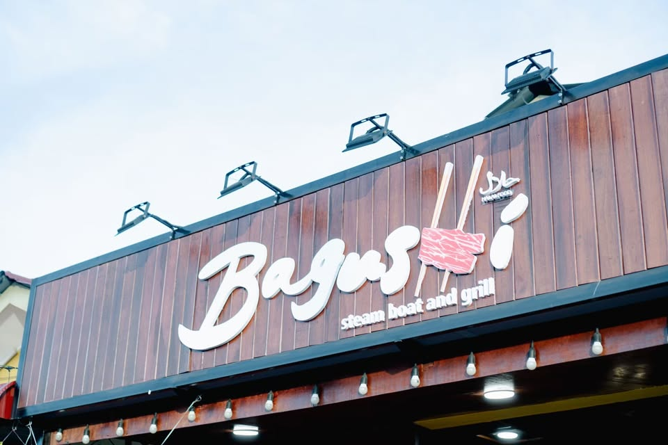

<!DOCTYPE html>
<html lang="en">
<head>
    <meta charset="UTF-8">
    <meta name="viewport" content="width=device-width, initial-scale=1.0">
    <title>Bagushi Steamboat & Grill Changlun</title>
    <link rel="stylesheet" href="https://cdnjs.cloudflare.com/ajax/libs/font-awesome/6.4.0/css/all.min.css">
    
</head>
<body>

    <!-- PAGE 1: Welcome Screen (Based on Design 1)[cite: 6] -->
    

        

            <i class="fa-solid fa-bars"></i>
            

                <i class="fa-regular fa-bell"></i> &nbsp;
                <i class="fa-solid fa-share-nodes"></i> &nbsp;
                <i class="fa-solid fa-magnifying-glass"></i>
            

        

        
        <!-- Image placeholder atau gambar kedai -->
        

            
            <i class="fa-regular fa-image" style="position: absolute;"></i>
        

        <h1 class="title-large" style="font-size: 1.6rem; line-height: 1.2; margin-bottom: 10px;">BAGUSHI STEAMBOAT & GRILL CHANGLUN</h1>
        
Welcome!

        
        <button class="btn-primary" onclick="goToPage(2)">Start Ordering</button>
    

    <!-- PAGE 2: Sign In Form -->
    

        

            <i class="fa-solid fa-chevron-left" onclick="goToPage(1)"></i>
            Sign In
            <i></i>
        

        <h1 class="title-large" style="font-size: 1.3rem; margin-bottom: 20px;">Customer Sign In</h1>
        
        <input type="text" id="loginEmail" class="form-input" placeholder="Name / Email" required>
        
        

            <input type="password" id="loginPassword" class="form-input" placeholder="Password" required style="padding-right: 40px; margin-bottom: 0;">
            <i class="fa-solid fa-eye toggle-password" id="togglePassword" onclick="togglePasswordVisibility()" style="position:absolute; right:15px; top:40%; transform:translateY(-50%); cursor:pointer; color:#777;"></i>
        

        
        <button class="btn-primary" style="margin-top: 25px;" onclick="handleSignIn()">Continue</button>
        

            <small onclick="goToPage(9)" style="cursor: pointer; text-decoration: underline; color: #666;">(Staff / Kitchen Dashboard - Page 9)</small>
        

    

    <!-- PAGE 3: Confirm Table Number (Based on Design 2)[cite: 7] -->
    

        

            <i class="fa-solid fa-bars"></i>
            

                <i class="fa-regular fa-bell"></i> &nbsp;
                <i class="fa-solid fa-share-nodes"></i> &nbsp;
                <i class="fa-solid fa-magnifying-glass"></i>
            

        

        
        

            
            <i class="fa-regular fa-image" style="position: absolute;"></i>
        

        <h2 class="title-large" style="margin-bottom: 5px;">Confirm Your Table</h2>
        
Your table number has been detected from the QR code

        
        

            <label style="font-size: 0.9rem; font-weight: bold; display: block; margin-bottom: 8px;">Table Number</label>
            <select id="selectMeja" class="form-input" style="text-align: center; margin-bottom: 0;">
                <option value="Table 05">05</option>
                <option value="Table 01">01</option>
                <option value="Table 02">02</option>
                <option value="Table 08">08</option>
                <option value="Table 12">12</option>
            </select>
        

        
        
Tap the arrow if the detected table number is incorrect

        <button class="btn-primary" onclick="confirmTable()">Confirm</button>
    

    <!-- PAGE 4: Menu Categories Selection -->
    

        

            Menu Categories
            <i class="fa-solid fa-cart-shopping" onclick="goToPage(7)" style="font-size:1.3rem; position:relative;">
                0
            </i>
        

        <input type="text" id="searchMenuInput" class="form-input" placeholder="🔍 Search all 54 items..." oninput="filterMenu(this.value)">
        
        

            
Search Results:

            

            

        

        

            
Select Category:

            

                
Sup / Dapur

                
Sos Pencicah

                
Daging

                
Ayam

                
Seafood

                
Bebola & Steamboat

                
Mee

                
Sayur

                
Side Dish

                
Minuman

                
Alacarte Add On

                
Set Menu

            

        

        <button class="btn-primary" style="margin-top: 10px;" onclick="filterByCategory('All')">View All Menu Items</button>
    

    <!-- PAGE 5: Filtered Menu List -->
    

        

            

                <i class="fa-solid fa-chevron-left" onclick="goToPage(4)"></i>
                Menu List
            

            

                <i class="fa-solid fa-bag-shopping" onclick="goToPage(7)" style="font-size: 1.2rem; cursor: pointer; position:relative;">
                    0
                </i>
            

        

        

        <button class="btn-primary" onclick="goToPage(7)">Go to Cart (0)</button>
    

    <!-- PAGE 6: Product Detail & Special Request -->
    

        

            <i class="fa-solid fa-chevron-left" onclick="goToPage(5)"></i>
            

                <i class="fa-solid fa-bag-shopping" onclick="goToPage(7)" style="font-size: 1.2rem; cursor: pointer; position:relative;">
                    0
                </i>
            

        

        <h2 id="detailName" style="margin-bottom: 10px;">Item Name</h2>
        

            
        

        
Price: RM 0.00

        

        <label style="font-weight: bold; display: block; margin-top: 10px; margin-bottom: 5px;">Special Request:</label>
        <input type="text" id="specialRequest" class="form-input" placeholder="E.g., Less spicy / Extra soup">

        <button class="btn-primary" onclick="addCurrentDetailToCart()">Add to Cart</button>
    

    <!-- PAGE 7: My Cart & Checkout (Based on Design 3)[cite: 8] -->
    

        

            <i class="fa-solid fa-chevron-left" onclick="goToPage(5)"></i>
            <h2 style="font-size: 1.3rem;">My cart</h2>
        

        <!-- Table Number Card -->
        

            
<i class="fa-solid fa-chair"></i>

            

                <small style="color: #666; font-size: 0.8rem;">Table Number</small>
                <h3 id="cartTableDisplay" style="font-size: 1.1rem;">Table 5</h3>
            

        

        
Your Order

        <!-- Dynamic Cart Items Container -->
        

        

            

                Total
                RM 0.00
            

            <button class="btn-primary" style="border-radius: 12px;" onclick="placeOrder()">Place Order</button>
        

    

    <!-- PAGE 8: Customer Order Status (Based on Design 4)[cite: 9] -->
    

        

            <i class="fa-solid fa-chevron-left" onclick="goToPage(7)"></i>
            <h2 class="header-title" style="font-size: 1.1rem;">Order Status</h2>
            <i></i>
        

        <!-- Success Notification Card -->
        

            

                <i class="fa-solid fa-check"></i>
            

            <h3 style="font-size: 1.1rem; margin-bottom: 5px;">Order Successfully Placed!</h3>
            
Your order has been sent to the staff.

        

        
Order Progress

        

            

                
<i class="fa-solid fa-check" style="font-size: 0.9rem;"></i>

                Order Receive
            

            

                

                Preparing
            

            

                

                Ready to Serve
            

        

        <button class="btn-primary" style="margin-top: auto; border-radius: 12px;" onclick="goToPage(9)">Go to Staff Dashboard (Page 9)</button>
    

    <!-- PAGE 9: Kitchen / Incoming Orders Dashboard -->
    

        

            <i class="fa-solid fa-chevron-left" onclick="goToPage(1)"></i>
            <h2 class="header-title">Incoming Orders</h2>
        

        

            <button class="btn-primary" style="padding: 6px; font-size:0.75rem; border-radius:8px; margin-top:0;">All (3)</button>
            <button class="btn-primary" style="padding: 6px; font-size:0.75rem; border-radius:8px; margin-top:0; background:#888;">Preparing (2)</button>
            <button class="btn-primary" style="padding: 6px; font-size:0.75rem; border-radius:8px; margin-top:0; background:#888;">Ready (1)</button>
        

        <table>
            <thead>
                <tr>
                    <th>Table No.</th>
                    <th>Items</th>
                    <th>Time</th>
                    <th>Status</th>
                    <th>Action</th>
                </tr>
            </thead>
            <tbody>
                <tr>
                    <td>05</td>
                    <td>Sliced Beef x1 Chicken x2</td>
                    <td>1:00 PM</td>
                    <td>Done</td>
                    <td><button style="padding:2px 6px;" onclick="goToPage(10)">View</button></td>
                </tr>
                <tr>
                    <td>12</td>
                    <td>Fishball x5 Crabsticks x2</td>
                    <td>1:03 PM</td>
                    <td>In prog...</td>
                    <td><button style="padding:2px 6px;" onclick="goToPage(10)">View</button></td>
                </tr>
                <tr>
                    <td>08</td>
                    <td>Squid x1 Prawns x1</td>
                    <td>1:06 PM</td>
                    <td>Not sta...</td>
                    <td><button style="padding:2px 6px;" onclick="goToPage(10)">View</button></td>
                </tr>
            </tbody>
        </table>
    

    <!-- PAGE 10: Kitchen / Update Order Status -->
    

        

            <i class="fa-solid fa-chevron-left" onclick="goToPage(9)"></i>
            <h2 class="header-title">Update Order Status</h2>
        

        

            <h3 style="margin-bottom: 10px;">Table No 5</h3>
            

                Sliced Beef x1 
                Chicken x2
            

        

        <label style="font-weight: bold; display: block; margin-bottom: 8px;">Status:</label>
        <select class="form-input" style="height: 45px;">
            <option value="Done">Done</option>
            <option value="In Progress">In Progress</option>
            <option value="Not Started">Not Started</option>
        </select>

        <button class="btn-primary" style="margin-top: 15px; border-radius:12px;" onclick="alert('Order status updated successfully!'); goToPage(9);">Update Status</button>
    

</body>
</html>